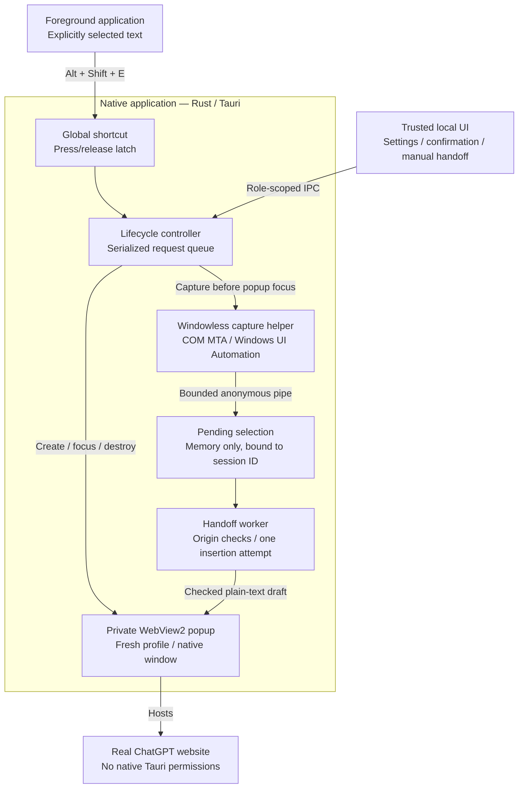
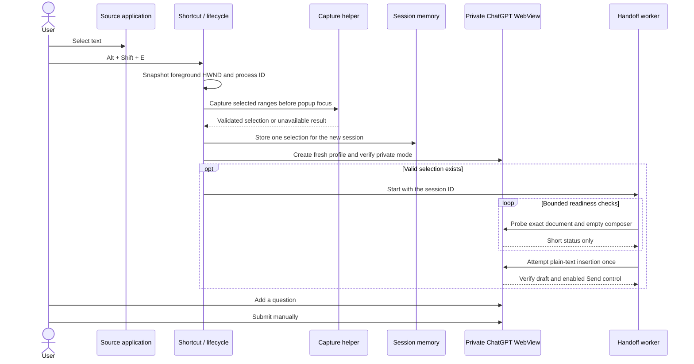
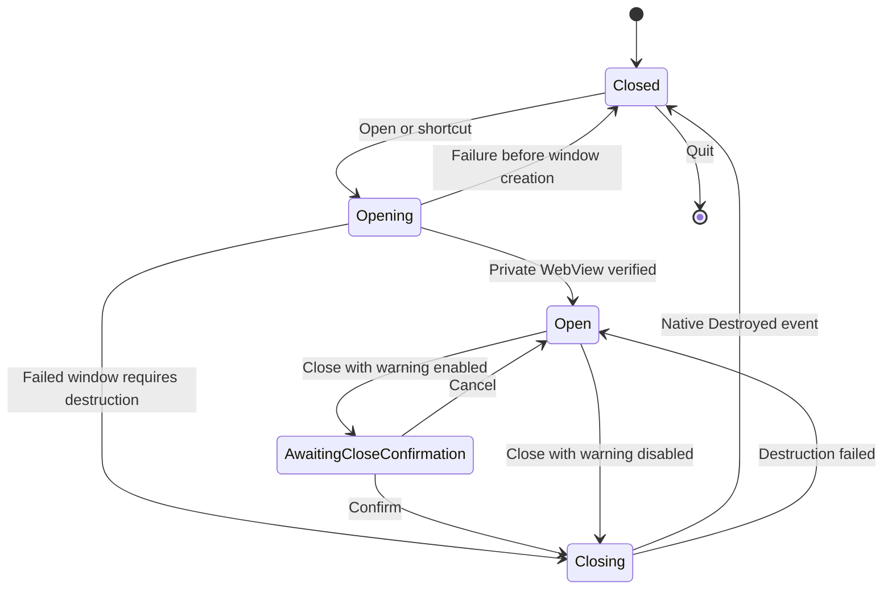

# ChatGPT Island

**Select text. Press a shortcut. Ask ChatGPT in a private floating window.**

ChatGPT Island is a Windows tray utility that brings selected text from supported applications into an editable draft on the real ChatGPT website. Add your question and send it yourself.

Built with **Tauri 2, Rust, Microsoft WebView2, and TypeScript**. No OpenAI API key, custom chat frontend, Node.js backend, or application account is required. ChatGPT guest availability still depends on the website and network.

> **Project status:** The native application, text capture, and draft handoff are implemented. Selected workflows have been verified on the development machine; broader compatibility and reliability checks remain incomplete. Windows installer/distribution work has not started. See [verification and limitations](#verification-and-limitations).

## Contents

- [Using the app](#using-the-app)
- [Architecture](#architecture)
- [From selection to draft](#from-selection-to-draft)
- [Technical decisions](#technical-decisions)
- [Session lifecycle](#session-lifecycle)
- [Security and data handling](#security-and-data-handling)
- [Source layout](#source-layout)
- [Development and builds](#development-and-builds)
- [Verification and limitations](#verification-and-limitations)
- [Further documentation](#further-documentation)

## Using the app

Run the built `.exe`. Normal startup creates a tray icon, with no launcher or empty window. Windows may place the icon under hidden tray icons. Run one instance at a time so the shortcut is available.

1. Select text in a supported application, such as Notepad or Opera.
2. Press **Alt + Shift + E**.
3. Wait for the private ChatGPT popup to prepare the selected text as a draft.
4. Add your question after **My question:**.
5. Press ChatGPT's **Send** button yourself.

Without a valid selection, the popup opens normally. Opening from the tray also opens/focuses the browser without initiating text capture.

| Control | Behavior |
|---|---|
| **Alt + Shift + E** | Capture and open when closed; request closure when open |
| **Escape** in the popup | Request closure; does not intercept Escape in other applications |
| **Alt + F4** | Request closure through the same confirmation flow |
| Tray **Open ChatGPT Island** | Open a fresh popup or focus the current one |
| Tray **Settings** | Shortcut diagnostics, close-warning preference, clipboard fallback, and optional manual handoff |
| Tray **Quit** | Request application exit; see the remaining tray verification limitation below |
| **Alt + F7 / Alt + F8** in the popup | Native keyboard move/resize mechanisms; finish with arrow keys and Enter |

The popup has no application title bar, address bar, tabs, or custom chat controls. It starts at approximately **520 × 660 logical pixels**, constrained to the source monitor's working area. Native shadow and rounded corners are requested where supported; an exact corner radius is not guaranteed.

Closing normally offers **Cancel**, **Close conversation**, and **Don't show this again**. Cancel preserves the page and draft. Confirm destroys the popup; the tray application stays running. Settings can re-enable the warning.

### When automatic preparation is unavailable

The ChatGPT popup stays open on its own. **No extra handoff window opens automatically.**

If needed, choose **Settings → Open manual handoff**. Select the prepared draft, copy it with Ctrl+C, return to ChatGPT, and paste once. Check the composer first: insertion may have succeeded even when verification was uncertain. Manual copying deliberately replaces your clipboard contents.

## Architecture

Rust owns Windows integration, session state, and native window operations. Small local TypeScript pages provide trusted controls. The popup itself hosts the real remote website.



There is one active popup and at most one pending selection. Capture and handoff are separate components: the handoff reads session-owned text rather than calling system-wide capture APIs again.

### Thread and process boundaries

- **Native callbacks** enqueue lifecycle requests. A single worker serializes opening, closing, confirmation, settings writes, and manual-notice creation.
- **Capture runs in a temporary helper process.** The helper uses a COM multithreaded apartment and communicates with the parent through a size-limited anonymous pipe. A **1,500 ms watchdog** terminates a stalled attempt; process startup and termination add operating-system overhead.
- **Handoff has its own bounded worker.** It checks composer readiness for up to roughly **15 seconds**, with bounded script callbacks. It never installs a permanent page observer.
- **WebView operations** are dispatched through Tauri to the owning UI thread. Potentially blocking UI Automation work does not run there.

## From selection to draft

Capturing before focus is essential: activating the popup first would make Island the foreground application and lose the original selection context.



### Capture policy

UI Automation starts at the focused control and reads its selected text ranges. It does not request the whole document or scan all running applications. Password indicators, inaccessible controls, protected desktops, foreground changes, and provider errors cause capture to stop safely.

Validation trims outer whitespace, preserves internal line breaks and Unicode, and rejects empty, whitespace-only, NUL-containing, or oversized input. The limit is **10,000 Unicode scalar values**, not bytes or grapheme clusters. Oversized selections are rejected rather than silently truncated.

The optional **capture clipboard fallback** is separate from manual draft copying. It is disabled by default and requires both a positively identified selected range whose UIA text read failed and an initially empty clipboard. Unsupported accessibility alone never triggers a blind Ctrl+C. Existing formats cause refusal; sequence and owner checks guard restoration. Focus changes, delayed copying, and clipboard managers can still race, so perfect preservation is not claimed.

### Composer adapter

The adapter checks both the native URL and the executing document. Automatic handoff is limited to the exact `https://chatgpt.com` home document, with no query or fragment. It requires one visible, enabled, editable composer and preserves existing draft text.

Current candidates include the desktop `prompt-textarea` and observed mobile `mobile-composer-prompt` controls. Textareas use the native value setter plus an input event; contenteditable controls use browser plain-text editing. Selected text is JSON-serialized as data, never inserted as executable statements or HTML.

Insertion is claimed once per session. An uncertain callback, rerender, navigation, or failed verification does not cause repeated insertion. The adapter never presses Enter, clicks Send, submits a form, reads cookies, or calls undocumented ChatGPT endpoints.

## Technical decisions

| Decision | Reason | Tradeoff |
|---|---|---|
| **Tauri 2 + Rust native core** | Keep Windows APIs, lifecycle ownership, and permissions in native code while using small web-based local controls. | Windows toolchain and native integration are required. |
| **WebView2 hosting the actual site** | Reuse ChatGPT's composer, conversation UI, and normal follow-up behavior. | Guest access and website changes remain outside the application's control. |
| **UI Automation before clipboard access** | Read explicit selections without normally modifying shared clipboard state. | Provider support differs by application and control. |
| **Process isolation for capture** | A hung accessibility provider can be terminated without leaving a stuck capture thread in the main application. | Each capture pays helper startup and pipe overhead. |
| **One serialized lifecycle queue** | Prevent duplicate popups, overlapping close dialogs, and conflicting native operations. | Lifecycle requests wait behind earlier work, including bounded capture. |
| **Session IDs + cancellation + one insertion claim** | Prevent stale callbacks or duplicate readiness events from replaying text into another session. | Uncertain insertion results are not retried automatically. |
| **Fresh, verified-private browser profiles** | Keep each popup separate from normal browser profiles and previous Island sessions. | Profile directories are retained until safe cleanup can be established. |
| **Narrow composer adapter** | Prepare an editable draft without implementing another chat UI or backend. | Selectors and editing behavior depend on the current website; the contenteditable editing API is compatibility-sensitive. |
| **User-controlled submission** | Leave the decision to send selected content with the user. | Preparing input still exposes it to the website's scripts before Send. |
| **Explicit manual fallback** | Keep ordinary use to a single floating ChatGPT window and avoid surprise clipboard writes. | When automation cannot be confirmed, recovery requires a deliberate Settings action. |
| **Native borderless window behavior** | Keep website interaction unobstructed, without a draggable overlay or privileged drag API in the page. | Corners, borders, keyboard move/resize, and mixed-DPI behavior depend on Windows support. |
| **Docker for frontend work; Windows for native work** | Make compatible checks reproducible without pretending a Linux container can validate WebView2 or Windows input. | Native verification remains a separate workflow. |

## Session lifecycle



**Destroy, not hide:** confirmed closure destroys the native window/WebView. Selection and handoff state are released, and reopening creates another UUID profile. The controller waits for actual destruction before allowing a new popup.

**Cancel preserves the session:** the current conversation and draft remain. The skip-warning checkbox is saved only on affirmative confirmation. Stale session events cannot clear a newer session's selection.

**Quit uses the same safeguards:** when a conversation is open, exit can wait for confirmation and destruction. Force termination, crashes, and operating-system shutdown cannot be guaranteed to show the warning. Actual tray Quit delivery remains an outstanding verification item.

## Security and data handling

### Trust boundary

The remote ChatGPT popup has **no Tauri capabilities**. It cannot initiate capture, read native application state, change settings, access files, or invoke shell commands through Island.

Local settings, confirmation, manual-handoff, and development windows have separate exact-label capabilities. Commands also validate their invoking window. Website navigation is restricted to the exact HTTPS ChatGPT host on port 443; new windows and downloads are denied. There is no authentication, CAPTCHA, or rate-limit bypass.

### What is stored

| Data | Location and lifetime |
|---|---|
| Selected text | Temporary helper/parent memory; one pending value owned by the active session |
| Prepared draft | Temporary application memory and, after insertion, the real ChatGPT page |
| Preferences | Two booleans in the application configuration directory: `skip_close_confirmation` and `clipboard_fallback_enabled` |
| WebView profile directories | Fresh application-owned directory per session; retained and never reused |
| Application conversation history | No application-managed conversation database or history feature |

Preferences are written through a flushed temporary file and atomic Windows replacement. Corrupt or missing preferences default to close warnings enabled and capture clipboard fallback disabled.

Typical paths:

```text
%APPDATA%\com.chatgptisland.dev\settings.json
%LOCALAPPDATA%\com.chatgptisland.dev\private-sessions\island-<uuid>\
```

Island does not intentionally write selected text or drafts to its settings, logs, files, or analytics. Ordinary memory release is not a secure-wipe guarantee. Private WebView profile directories may contain residual runtime data: automatic deletion is not implemented because window destruction alone does not prove every browser process has released its files. Only remove app-owned profiles offline after confirming their resources are no longer in use.

**Draft preparation is not message submission.** Once inserted, selected text is accessible to ChatGPT's page scripts before Send. Island makes no hidden network request for handoff, but cannot guarantee the website's own draft processing or pre-submission network behavior. Local closure does not erase remote service data.

## Source layout

```text
src/
├── main.ts                  # Route trusted local views
├── trusted-ui.ts            # Settings, close confirmation, optional manual handoff
├── launcher.ts              # Debug-only launcher
├── composer-script.js       # Narrow adapter embedded by Rust
└── styles.css               # Local UI styling

src-tauri/
├── capabilities/            # Separate permissions for each trusted local role
└── src/
    ├── lib.rs               # Runtime, tray/plugin setup, native window events
    ├── lifecycle.rs         # State machine, request queue, session ownership
    ├── shortcuts.rs         # Global shortcut and key-repeat suppression
    ├── tray.rs              # Tray resources and menu dispatch
    ├── popup.rs             # Private WebView, private-mode check, native keys
    ├── window_layout.rs     # Monitor work areas, DPI, bounds, native corners
    ├── session.rs           # Unique profile directories and navigation policy
    ├── settings.rs          # Preference schema and atomic persistence
    ├── confirmation.rs      # Trusted local window creation
    ├── text_capture/        # UIA, clipboard policy, validation, bounded helper
    └── handoff/             # Draft construction, readiness, one-shot insertion

tests/                       # JavaScript/security tests and sample fixtures
scripts/                     # Docker and native verification entry points
docs/                        # Design details, compatibility, recorded evidence
```

Rust unit tests live alongside their modules. `composer-script.js` is embedded in the native binary; changing it requires rebuilding Rust, not just frontend hot reload.

## Development and builds

### Requirements

- Windows 10/11 x64; platform behavior beyond the recorded host remains subject to verification.
- Microsoft Edge WebView2 Evergreen Runtime.
- Node.js 24 LTS and npm.
- Rust MSVC toolchain, Microsoft C++ Build Tools, and a Windows SDK.
- Docker Desktop for the optional containerized frontend workflow.

End users running a built executable do not need Node.js, Rust, or Docker. WebView2 is still required. Detailed setup is in [DEVELOPMENT.md](docs/DEVELOPMENT.md).

### Run from source

```powershell
git clone https://github.com/iiMedR/chatgpt-island.git
cd chatgpt-island
npm ci
npm run tauri dev
```

Keep the development terminal open. Startup is tray-only; use the shortcut or tray menu. Quit any other Island instance before launching another.

### Build a standalone executable

```powershell
npm run tauri build -- --no-bundle
```

Output:

```text
src-tauri/target/release/chatgpt-island.exe
```

Frontend assets are embedded in the application. Installer bundling is currently disabled; a standalone executable build is not an installer or a published GitHub Release.

### Verification commands

Use the workflow appropriate to the changed component. A documentation-only edit does not need an application rebuild or GUI test sweep.

| Scope | Command |
|---|---|
| Containerized TypeScript, JS/security tests, frontend build | `docker compose build` then `docker compose run --rm dev` |
| Complete Windows development checks | `.\scripts\verify.ps1` |
| Rust tests only | `cargo test --locked --manifest-path src-tauri/Cargo.toml` |
| TypeScript only | `npm run typecheck` |

The Docker image uses a digest-pinned Node base, lockfile installation, a non-root user, dropped capabilities, and no host mounts or published ports. It does not run native Windows UI Automation, global shortcuts, or WebView2.

## Verification and limitations

Recorded results describe specific versions, controls, and host conditions—not universal Windows support.

| Area | Recorded status |
|---|---|
| Guest ChatGPT conversation and fresh-session feasibility | Verified in the foundation milestone on the development host/network |
| Selection capture in Notepad, Opera, Chrome, and Edge | Verified for the tested controls |
| Default VS Code editor capture | Visible selection was not returned by its accessibility provider |
| Notepad selection → editable ChatGPT draft | Verified with English, French, Arabic, multiline text, and emoji; Send was not activated |
| Current mobile composer | Verified; desktop contenteditable and other layouts remain unverified |
| Borderless popup and native rounded edges | Observed on the development host |
| Native clipboard fallback, Word/PDF, mixed DPI, multiple monitors, hot unplug, keyboard move/resize | Remaining native coverage |
| Physical tray Quit delivery and shortcut release | Outstanding verification item |
| Windows installer and distribution work | Not started |

Website layout changes, unavailable guest access, slow loading, protected controls, and inaccessible selections can prevent automatic preparation. Failures leave the browser usable; optional manual handoff is available from Settings without an automatic extra window. Escape currently takes precedence over website menus while the popup is focused.

Automated tests cover validation, state transitions, cancellation, origin checks, safe serialization, composer fixtures, clipboard policy, layout calculations, and capability boundaries. Passing them does not establish live website or cross-application compatibility. See the evidence documents for commands, results, and untested cases.

## Further documentation

- [Architecture](docs/ARCHITECTURE.md) — native modules, threading, trust boundaries, and implementation details.
- [Development](docs/DEVELOPMENT.md) — environment setup, debugging, and verification workflows.
- [Text capture compatibility](docs/TEXT_CAPTURE_COMPATIBILITY.md) — observed application support and capture limits.
- [ChatGPT handoff](docs/CHATGPT_HANDOFF.md) — composer assumptions, fallback behavior, and native evidence.
- [Foundation feasibility](docs/FEASIBILITY.md) — guest conversation and private-session observations.
- [Background and tray verification](docs/MILESTONE02.md) — lifecycle results and unresolved tray behavior.
- [Requirements](docs/REQUIREMENTS.md) and [progress](docs/PROGRESS.md) — scope, milestone status, and remaining work.
